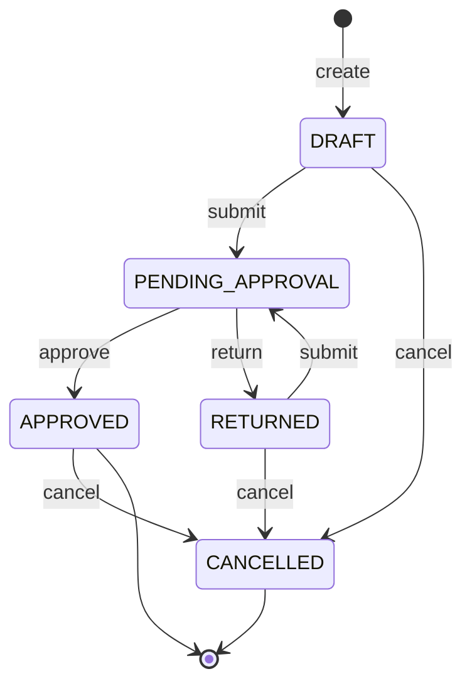
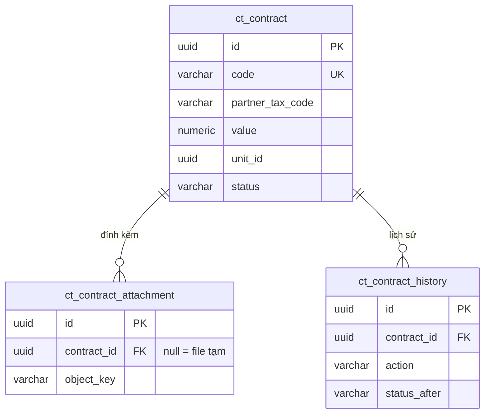

# FS-001 — Quản lý hợp đồng

> **Tài liệu mẫu.** Yêu cầu gốc chỉ có một câu, nên phần lớn chi tiết là giả định minh hoạ (xem mục 14). Dùng file này làm chuẩn về **mức chi tiết và cách trình bày**, không dùng làm nghiệp vụ thật.

## Lịch sử thay đổi

| Version | Ngày | Người | Nội dung |
|---|---|---|---|
| 1.0 | 2026-11-05 | ba-spec-writer | Khởi tạo |

## 1. Tóm tắt

- **Mục tiêu:** Số hoá việc lập, trình duyệt và huỷ hợp đồng với đối tác, thay cho trao đổi giấy/email. Mọi thay đổi trạng thái đều có lịch sử.
- **Đối tượng sử dụng:** Chuyên viên hợp đồng, Lãnh đạo đơn vị.
- **Trong phạm vi:**
  - Danh sách, tìm kiếm, xem chi tiết hợp đồng.
  - Tạo, sửa, xoá hợp đồng nháp; đính kèm file.
  - Trình duyệt, duyệt, trả lại, huỷ hợp đồng.
  - Lịch sử thao tác; email thông báo khi trình, duyệt, trả lại.
- **Ngoài phạm vi:** phụ lục hợp đồng, thanh toán theo đợt, ký số, nhắc hết hạn, xuất Excel, báo cáo thống kê.
- **Phụ thuộc:**
  - Xác thực, người dùng, vai trò, menu của core (`bom-sa`).
  - `core-storage` (lưu file), `core-email` (gửi email).

## 2. Thuật ngữ

| Thuật ngữ | Định nghĩa |
|---|---|
| Hợp đồng | Thoả thuận giữa đơn vị và một đối tác, có giá trị và thời hạn hiệu lực |
| Đối tác | Tổ chức ký hợp đồng với đơn vị, định danh bằng mã số thuế |
| Trình duyệt | Chuyên viên gửi hợp đồng cho lãnh đạo xem xét |
| Trả lại | Lãnh đạo yêu cầu chuyên viên sửa, kèm lý do |
| Đơn vị | Đơn vị của người dùng đăng nhập, lấy từ token |

## 3. Actor & phân quyền

| Vai trò | Xem | Tạo | Sửa | Xoá | Trình | Duyệt / Trả lại | Huỷ | Phạm vi dữ liệu |
|---|---|---|---|---|---|---|---|---|
| Chuyên viên hợp đồng (`CT_STAFF`) | ✔ | ✔ | ✔ (của mình) | ✔ (của mình) | ✔ (của mình) | | ✔ (của mình, khi chưa duyệt) | Hợp đồng thuộc đơn vị mình |
| Lãnh đạo đơn vị (`CT_MANAGER`) | ✔ | | | | | ✔ | ✔ (đã duyệt) | Hợp đồng thuộc đơn vị mình |

"Của mình" = `created_by` là người đăng nhập. Mã vai trò chỉ là gợi ý; vai trò tạo trong màn Quản lý vai trò của core và gán quyền theo mục 10.

## 4. Luồng nghiệp vụ

### 4.1 Luồng chính

1. Chuyên viên tạo hợp đồng (trạng thái `DRAFT`), đính kèm file.
2. Chuyên viên trình duyệt → `PENDING_APPROVAL`. Hệ thống gửi email cho Lãnh đạo của đơn vị.
3. Lãnh đạo duyệt → `APPROVED`. Hệ thống gửi email cho người tạo.

### 4.2 Luồng thay thế / ngoại lệ

- **A1 – Trả lại:** ở bước 3, Lãnh đạo trả lại kèm lý do → `RETURNED`, gửi email cho người tạo. Chuyên viên sửa rồi trình lại (quay về bước 2).
- **A2 – Huỷ trước khi duyệt:** Chuyên viên huỷ hợp đồng `DRAFT` hoặc `RETURNED` của mình, kèm lý do → `CANCELLED`.
- **A3 – Huỷ sau khi duyệt:** Lãnh đạo huỷ hợp đồng `APPROVED`, kèm lý do → `CANCELLED`.
- **A4 – Xoá nháp:** Chuyên viên xoá hợp đồng `DRAFT` của mình (xoá mềm). Hợp đồng đã từng trình thì không xoá được, chỉ huỷ.
- **E1 – Xung đột:** người khác đã đổi trạng thái trước → báo lỗi sai trạng thái và tải lại dữ liệu.

## 5. Trạng thái & chuyển trạng thái

Trạng thái: `DRAFT` (Nháp, khởi tạo) · `PENDING_APPROVAL` (Chờ duyệt) · `RETURNED` (Bị trả lại) · `APPROVED` (Đã duyệt, kết thúc) · `CANCELLED` (Đã huỷ, kết thúc)

| Từ trạng thái | Hành động (API) | Sang trạng thái | Điều kiện (guard) | Actor | Ghi lịch sử | Mã lỗi khi sai |
|---|---|---|---|---|---|---|
| — | create (API-03) | DRAFT | BR-01..BR-06 | CT_STAFF | CREATE | — |
| DRAFT, RETURNED | update (API-04) | giữ nguyên | Người tạo; BR-01..BR-06 | CT_STAFF | UPDATE | `contract.status.notEditable` |
| DRAFT | delete (API-05) | (xoá mềm) | Người tạo; chưa từng trình (BR-08) | CT_STAFF | — | `contract.status.notDeletable` |
| DRAFT, RETURNED | submit (API-06) | PENDING_APPROVAL | Người tạo; có ≥1 file (BR-07) | CT_STAFF | SUBMIT | `contract.status.invalidTransition` |
| PENDING_APPROVAL | approve (API-07) | APPROVED | Cùng đơn vị (BR-09) | CT_MANAGER | APPROVE | `contract.status.invalidTransition` |
| PENDING_APPROVAL | return (API-08) | RETURNED | Cùng đơn vị; có lý do (BR-10) | CT_MANAGER | RETURN | `contract.status.invalidTransition` |
| DRAFT, RETURNED | cancel (API-09) | CANCELLED | Người tạo; có lý do (BR-10) | CT_STAFF | CANCEL | `contract.status.invalidTransition` |
| APPROVED | cancel (API-09) | CANCELLED | Cùng đơn vị; có lý do (BR-10) | CT_MANAGER | CANCEL | `contract.status.invalidTransition` |

- Được sửa ở trạng thái: `DRAFT`, `RETURNED`.
- Được xoá ở trạng thái: `DRAFT`, khi chưa từng trình.
- Lịch sử ghi qua `ContractHistoryService.logStateChange(contract, action, source, statusBefore)`. Source: `CONTRACT_LIST` (thao tác từ danh sách) hoặc `CONTRACT_DETAIL` (thao tác từ trang chi tiết).

## 6. Business rules

| ID | Quy tắc | Áp dụng tại | Mã lỗi |
|---|---|---|---|
| BR-01 | Mã hợp đồng tự sinh khi tạo: `HD-{yyyy}-{5 số tăng dần trong năm}`, ví dụ `HD-2026-00001`. Người dùng không nhập, không sửa | API-03 | — |
| BR-02 | Tên hợp đồng bắt buộc, tối đa 255 ký tự | API-03, API-04 | `contract.name.notBlank`, `contract.name.tooLong` |
| BR-03 | Mã số thuế đối tác bắt buộc, gồm 10 chữ số hoặc dạng `10 chữ số-3 chữ số` | API-03, API-04 | `contract.partnerTaxCode.invalid` |
| BR-04 | Giá trị hợp đồng > 0, tối đa 2 chữ số thập phân | API-03, API-04 | `contract.value.invalid` |
| BR-05 | `effective_to` ≥ `effective_from`; `sign_date` ≤ `effective_from` | API-03, API-04 | `contract.effectiveDate.invalidRange`, `contract.signDate.afterEffectiveFrom` |
| BR-06 | File đính kèm: PDF/DOCX, ≤ 10 MB mỗi file, tối đa 5 file | API-03, API-04, API-11 | `contract.attachment.invalidType`, `contract.attachment.tooLarge`, `contract.attachment.tooMany` |
| BR-07 | Phải có ít nhất 1 file đính kèm mới được trình duyệt | API-06 | `contract.attachment.required` |
| BR-08 | Chỉ xoá hợp đồng `DRAFT` chưa từng trình (`submitted_at` rỗng) | API-05 | `contract.status.notDeletable` |
| BR-09 | Người dùng chỉ thấy và thao tác hợp đồng có `unit_id` = đơn vị của mình. Truy cập hợp đồng đơn vị khác → coi như không tồn tại | API-01..API-10 | `APP_DATA404` |
| BR-10 | Trả lại và huỷ bắt buộc có lý do, tối đa 1000 ký tự | API-08, API-09 | `contract.reason.notBlank` |
| BR-11 | Chuyên viên chỉ sửa/xoá/trình/huỷ hợp đồng do mình tạo | API-04, API-05, API-06, API-09 | `contract.notOwner` |

## 7. Data model

### 7.0 Nguồn & chế độ thiết kế

| Bảng | Chế độ | Nguồn |
|---|---|---|
| `ct_contract` | B — tự thiết kế | — (người dùng chưa có thiết kế DB) |
| `ct_contract_attachment` | B — tự thiết kế | — |
| `ct_contract_history` | B — tự thiết kế | — |
| `ct_contract_code_counter` | B — tự thiết kế | — |
| `sa_user`, `sa_role` (của core) | A — dùng nguyên | entity `bom-sa/entity/User.java`, `Role.java`. Chỉ đọc để tìm người nhận email, không sửa |

DDL: [`FS-001-quan-ly-hop-dong.sql`](FS-001-quan-ly-hop-dong.sql) (PostgreSQL; core chưa có Flyway/Liquibase).

### ENT-01 `ct_contract` — Hợp đồng

Kế thừa: `EntitySoftDeleteBase` (yêu cầu giữ bản nháp đã xoá để tra soát — xem giả định G-04). Cột audit và cột xoá mềm không liệt kê ở đây, nhưng có trong DDL.

| Cột | Kiểu | Null | Mặc định | Ràng buộc | Mô tả |
|---|---|---|---|---|---|
| id | uuid | N | | PK | |
| code | varchar(20) | N | | unique | Mã tự sinh (BR-01) |
| name | varchar(255) | N | | | Tên hợp đồng |
| partner_name | varchar(255) | N | | | Tên đối tác |
| partner_tax_code | varchar(14) | N | | BR-03 | MST đối tác |
| sign_date | date | N | | | Ngày ký |
| effective_from | date | N | | | Hiệu lực từ |
| effective_to | date | N | | ≥ effective_from | Hiệu lực đến |
| value | numeric(18,2) | N | | > 0 | Giá trị |
| currency | varchar(3) | N | `VND` | `VND`, `USD` | Loại tiền |
| description | varchar(2000) | Y | | | Ghi chú |
| unit_id | uuid | N | | | Đơn vị sở hữu, lấy từ token khi tạo |
| status | varchar(20) | N | `DRAFT` | CHECK theo `ContractStatus` | |
| submitted_at | timestamp | Y | | | Lần trình gần nhất |
| approved_by | varchar(50) | Y | | | Username người duyệt (cùng độ dài `created_by`) |
| approved_at | timestamp | Y | | | |
| reason | varchar(1000) | Y | | | Lý do trả lại/huỷ gần nhất |

- **Quan hệ:** 1 hợp đồng – n file đính kèm (ENT-02); 1 hợp đồng – n lịch sử (ENT-03).
- **Ràng buộc:** `ck_ct_contract_value` (`value > 0`), `ck_ct_contract_effective` (`effective_to >= effective_from`), `ck_ct_contract_sign_date` (`sign_date <= effective_from`), `ck_ct_contract_currency`, `ck_ct_contract_status`.
- **Index / unique:** unique `code` (không bỏ qua bản ghi đã xoá, vì mã không bao giờ dùng lại); index `(unit_id, status)` cho danh sách + phân quyền; index `partner_tax_code`.
- **Enum:** `ContractStatus` = `DRAFT` (Nháp), `PENDING_APPROVAL` (Chờ duyệt), `RETURNED` (Bị trả lại), `APPROVED` (Đã duyệt), `CANCELLED` (Đã huỷ).

### ENT-02 `ct_contract_attachment` — File đính kèm

Kế thừa: `EntityBase`. Xoá cứng khi người dùng gỡ file khỏi hợp đồng nháp.

| Cột | Kiểu | Null | Mặc định | Ràng buộc | Mô tả |
|---|---|---|---|---|---|
| id | uuid | N | | PK | |
| contract_id | uuid | Y | | FK → ct_contract.id | Rỗng = file tạm vừa upload qua API-11, chưa gắn vào hợp đồng |
| file_name | varchar(255) | N | | | Tên gốc |
| object_key | varchar(500) | N | | | Khoá đối tượng trên MinIO |
| content_type | varchar(100) | N | | | |
| size_bytes | bigint | N | | ≤ 10 485 760 | |

- **Index:** `contract_id`; `(created_date) WHERE contract_id IS NULL` cho job dọn file tạm.

### ENT-03 `ct_contract_history` — Lịch sử thao tác

Kế thừa: `EntityBase` (`created_by`, `created_date` = người và thời điểm thao tác). Chỉ thêm, không sửa/xoá.

| Cột | Kiểu | Null | Mặc định | Ràng buộc | Mô tả |
|---|---|---|---|---|---|
| id | uuid | N | | PK | |
| contract_id | uuid | N | | FK → ct_contract.id | |
| action | varchar(20) | N | | enum `ContractHistoryAction` | CREATE, UPDATE, SUBMIT, APPROVE, RETURN, CANCEL |
| source | varchar(30) | N | | enum `ContractHistorySource` | CONTRACT_LIST, CONTRACT_DETAIL |
| status_before | varchar(20) | Y | | | |
| status_after | varchar(20) | N | | | |
| note | varchar(1000) | Y | | | Lý do (nếu có) |

- **Index:** `(contract_id, created_date)` cho tab Lịch sử.

### ENT-04 `ct_contract_code_counter` — Bộ đếm mã hợp đồng

Không kế thừa base class (bảng kỹ thuật, không cần audit). Không có entity/màn hình; service gọi qua native query.

| Cột | Kiểu | Null | Mặc định | Ràng buộc | Mô tả |
|---|---|---|---|---|---|
| year | integer | N | | PK | Năm |
| last_value | integer | N | 0 | ≥ 0 | Số thứ tự đã cấp gần nhất |

### 7.x ERD

### 7.y Quyết định thiết kế (chế độ B)

| Quyết định | Lý do | Phương án đã cân nhắc |
|---|---|---|
| Trạng thái, loại tiền, hành động lịch sử dùng `varchar` + `CHECK` | Thêm giá trị chỉ cần sửa CHECK; khớp quy ước core | Kiểu enum Postgres: khó thêm giá trị, lệch core |
| `unit_id` không đặt FK tới `sa_unit` | `sa_unit` của core là bảng tham chiếu, mỗi dự án tự nạp dữ liệu; FK làm hỏng việc tạo hợp đồng khi bảng đơn vị chưa đồng bộ | FK cứng — xem Q-07 |
| Đối tác lưu thẳng trong `ct_contract` (`partner_name`, `partner_tax_code`) | Chưa có danh mục đối tác (G-05); tên đối tác tại thời điểm ký là dữ liệu cần giữ nguyên | Bảng `ct_partner` riêng — để giai đoạn sau (Q-02) |
| Chỉ lưu `reason` gần nhất trên hợp đồng; toàn bộ lý do nằm trong `ct_contract_history.note` | Màn chi tiết chỉ hiện lý do gần nhất; lịch sử đầy đủ đã có bảng riêng | Bảng lý do riêng: thừa |
| File tạm dùng chung bảng `ct_contract_attachment` với `contract_id` rỗng | Không cần bảng thứ hai; job dọn dẹp chỉ cần một điều kiện | Bảng `ct_upload_temp` riêng |
| Mã `HD-yyyy-NNNNN` sinh từ bảng đếm theo năm (ENT-04), tăng bằng một câu `INSERT ... ON CONFLICT DO UPDATE ... RETURNING` | Tránh trùng khi tạo đồng thời và tự đánh số lại mỗi năm (BR-01) | `MAX(code)+1`: trùng khi đồng thời; Postgres `SEQUENCE`: không tự về 1 khi sang năm |

### 7.z Đề xuất thay đổi DB

Không áp dụng – không sửa bảng có sẵn nào; bảng của core chỉ được đọc.

## 8. API

Base path: `/ct/contract` · Response bọc `Response<T>` · Mọi endpoint kiểm tra quyền.

| ID | Method | Path | Mô tả | Quyền (button_action) |
|---|---|---|---|---|
| API-01 | GET | /search | Tìm kiếm phân trang | view |
| API-02 | GET | /{id} | Chi tiết + file đính kèm | view |
| API-03 | POST | /create | Tạo mới | create |
| API-04 | POST | /update | Cập nhật | update |
| API-05 | POST | /delete | Xoá nháp | delete |
| API-06 | POST | /submit | Trình duyệt | submit |
| API-07 | POST | /approve | Duyệt | approve |
| API-08 | POST | /return | Trả lại | return |
| API-09 | POST | /cancel | Huỷ | cancel |
| API-10 | GET | /history | Lịch sử theo hợp đồng | view |
| API-11 | POST | /attachment/upload | Tải file lên (multipart) | create, update |
| API-12 | GET | /attachment/{attachmentId}/download | Tải file về | view |

### API-01 GET /search

**Request (`ContractFilterRequest`, query):**

| Trường | Kiểu | Bắt buộc | Kiểu lọc | Mô tả |
|---|---|---|---|---|
| keyword | string | | chứa, không phân biệt hoa thường (code, name, partner_name) | |
| partnerTaxCode | string | | bằng | |
| status | string[] | | trong danh sách | |
| effectiveFrom | date | | `effective_to` ≥ giá trị | Còn hiệu lực từ ngày |
| effectiveTo | date | | `effective_from` ≤ giá trị | Còn hiệu lực đến ngày |
| page, size, sort | | | | Mặc định `created_date,desc` |

Luôn lọc thêm `unit_id` = đơn vị hiện tại và `is_deleted = false` (BR-09).

**Response:** `PageResult<ContractResponse>`

| Trường | Kiểu | Mô tả |
|---|---|---|
| id | uuid | |
| code | string | |
| name | string | |
| partnerName | string | |
| value | number | |
| currency | string | |
| effectiveFrom, effectiveTo | date | |
| status | string | |
| createdBy | string | |
| createdDate | datetime | |

### API-02 GET /{id}

**Response:** `ContractDetailResponse` = toàn bộ trường của ENT-01 (trừ `is_deleted`) + `attachments: [{ id, fileName, contentType, sizeBytes }]` + `canEdit`, `canSubmit`, `canApprove`, `canCancel` (boolean, tính theo trạng thái, người tạo và vai trò, để FE ẩn/hiện nút). Không tìm thấy, khác đơn vị hoặc đã xoá → `APP_DATA404`.

### API-03 POST /create

**Request (`ContractCreateRequest`, body):**

| Trường | Kiểu | Bắt buộc | Validate | Mã lỗi |
|---|---|---|---|---|
| name | string | ✔ | ≤ 255 | `contract.name.notBlank`, `contract.name.tooLong` |
| partnerName | string | ✔ | ≤ 255 | `contract.partnerName.notBlank` |
| partnerTaxCode | string | ✔ | BR-03 | `contract.partnerTaxCode.invalid` |
| signDate | date | ✔ | BR-05 | `contract.signDate.afterEffectiveFrom` |
| effectiveFrom | date | ✔ | | `contract.effectiveFrom.notNull` |
| effectiveTo | date | ✔ | BR-05 | `contract.effectiveDate.invalidRange` |
| value | number | ✔ | BR-04 | `contract.value.invalid` |
| currency | string | ✔ | `VND` \| `USD` | `contract.currency.invalid` |
| description | string | | ≤ 2000 | `contract.description.tooLong` |
| attachmentIds | uuid[] | | ≤ 5, là file tạm do API-11 trả về | `contract.attachment.tooMany` |

**Xử lý:**
1. Validate BR-02..BR-06.
2. Sinh `code` (BR-01); `unit_id` lấy từ `SecurityUtils.getCurrentUnitId(cacheService)`; `status = DRAFT`.
3. Gắn các file đính kèm.
4. Ghi lịch sử CREATE.

**Response:** `Response<UUID>` (id hợp đồng mới).

### API-04 POST /update

**Request (`ContractUpdateRequest`):** `id` (uuid, bắt buộc) + các trường như API-03. `attachmentIds` là danh sách **đầy đủ** sau khi sửa: file cũ không còn trong danh sách sẽ bị gỡ.

**Xử lý:**
1. Tìm hợp đồng (BR-09); kiểm tra người tạo (BR-11) và trạng thái `DRAFT`/`RETURNED`.
2. Validate như API-03 rồi cập nhật.
3. Ghi lịch sử UPDATE.

**Response:** `Response<Void>`.

### API-05 POST /delete

**Request (`ContractIdRequest`):** `id` (uuid). **Xử lý:** BR-09, BR-11, BR-08 → đặt `is_deleted = true`. **Response:** `Response<Void>`.

### API-06 POST /submit

**Request (`ContractIdRequest`):** `id`.

**Xử lý:**
1. Kiểm tra BR-09, BR-11, guard `DRAFT`/`RETURNED`, BR-07.
2. `status = PENDING_APPROVAL`, `submitted_at = now`, xoá `reason`.
3. Ghi lịch sử SUBMIT; gửi email `CT_CONTRACT_SUBMITTED`.

**Response:** `Response<Void>`.

### API-07 POST /approve

**Request (`ContractIdRequest`):** `id`.

**Xử lý:**
1. Kiểm tra BR-09, guard `PENDING_APPROVAL`.
2. `status = APPROVED`, `approved_by`, `approved_at`.
3. Ghi lịch sử APPROVE; gửi email `CT_CONTRACT_APPROVED`.

**Response:** `Response<Void>`.

### API-08 POST /return

**Request (`ContractReasonRequest`):** `id`, `reason` (BR-10).

**Xử lý:**
1. Kiểm tra BR-09, guard `PENDING_APPROVAL`.
2. `status = RETURNED`, `reason`.
3. Ghi lịch sử RETURN (note = reason); gửi email `CT_CONTRACT_RETURNED`.

**Response:** `Response<Void>`.

### API-09 POST /cancel

**Request (`ContractReasonRequest`):** `id`, `reason` (BR-10).

**Xử lý:**
1. Kiểm tra BR-09.
2. Chuyên viên: BR-11 + guard `DRAFT`/`RETURNED`. Lãnh đạo: guard `APPROVED`.
3. `status = CANCELLED`, `reason`.
4. Ghi lịch sử CANCEL.

**Response:** `Response<Void>`.

### API-10 GET /history

**Request (query):** `contractId` (uuid, bắt buộc). Kiểm tra BR-09.

**Response:** `List<ContractHistoryResponse>`: `action`, `source`, `statusBefore`, `statusAfter`, `note`, `createdBy`, `createdDate`. Sắp xếp `createdDate` tăng dần.

### API-11 POST /attachment/upload

**Request:** `multipart/form-data`, trường `file`.

**Xử lý:**
1. Validate BR-06 (loại, dung lượng).
2. Lưu lên MinIO qua `StorageService`.
3. Tạo bản ghi tạm (`contract_id` rỗng). Bản ghi tạm không được gắn sau 24 giờ thì job dọn dẹp xoá — xem Q-04.

**Response:** `{ id, fileName, contentType, sizeBytes }`.

### API-12 GET /attachment/{attachmentId}/download

Kiểm tra BR-09 qua hợp đồng chứa file. Trả luồng file với header `Content-Disposition: attachment`.

### Mã lỗi

| Mã | Tiếng Việt | English |
|---|---|---|
| `contract.name.notBlank` | Tên hợp đồng không được để trống | Contract name is required |
| `contract.name.tooLong` | Tên hợp đồng tối đa 255 ký tự | Contract name must be at most 255 characters |
| `contract.partnerName.notBlank` | Tên đối tác không được để trống | Partner name is required |
| `contract.partnerTaxCode.invalid` | Mã số thuế đối tác không hợp lệ | Partner tax code is invalid |
| `contract.signDate.afterEffectiveFrom` | Ngày ký không được sau ngày hiệu lực | Sign date must not be after the effective date |
| `contract.effectiveFrom.notNull` | Ngày hiệu lực không được để trống | Effective date is required |
| `contract.effectiveDate.invalidRange` | Ngày hết hiệu lực phải từ ngày hiệu lực trở đi | End date must be on or after the effective date |
| `contract.value.invalid` | Giá trị hợp đồng phải lớn hơn 0, tối đa 2 chữ số thập phân | Contract value must be greater than 0 with at most 2 decimals |
| `contract.currency.invalid` | Loại tiền không hợp lệ | Currency is invalid |
| `contract.description.tooLong` | Ghi chú tối đa 2000 ký tự | Description must be at most 2000 characters |
| `contract.attachment.invalidType` | Chỉ chấp nhận file PDF hoặc DOCX | Only PDF or DOCX files are allowed |
| `contract.attachment.tooLarge` | Mỗi file tối đa 10 MB | Each file must be at most 10 MB |
| `contract.attachment.tooMany` | Tối đa 5 file đính kèm | At most 5 attachments are allowed |
| `contract.attachment.required` | Cần ít nhất 1 file đính kèm để trình duyệt | At least one attachment is required to submit |
| `contract.reason.notBlank` | Vui lòng nhập lý do | Reason is required |
| `contract.notOwner` | Bạn chỉ được thao tác hợp đồng do mình tạo | You can only modify contracts you created |
| `contract.status.notEditable` | Hợp đồng ở trạng thái hiện tại không được sửa | The contract cannot be edited in its current status |
| `contract.status.notDeletable` | Chỉ xoá được hợp đồng nháp chưa từng trình | Only drafts that were never submitted can be deleted |
| `contract.status.invalidTransition` | Trạng thái hợp đồng đã thay đổi, vui lòng tải lại | The contract status has changed, please reload |
| `APP_DATA404` | (có sẵn trong core) | (built into core) |

## 9. Màn hình

### SCR-01 Danh sách hợp đồng

- **Đường dẫn FE:** `apps/web/src/pages/Contract/ContractList/index.tsx`
- **URL menu:** `/ct/contract` · **loadingType:** `table-list-actions`
- **i18n namespace:** `contract`

**Bộ lọc:**

| Trường | Control | Nguồn dữ liệu | Mặc định |
|---|---|---|---|
| Từ khoá | Searchfield | — | rỗng |
| Mã số thuế đối tác | Textfield | — | rỗng |
| Trạng thái | Select (chọn nhiều) | `ContractStatus` | tất cả |
| Hiệu lực từ – đến | DatePicker × 2 | — | rỗng |

**Bảng:**

| Cột | Trường | Định dạng | Sắp xếp |
|---|---|---|---|
| Chọn | — | checkbox | |
| Mã hợp đồng | code | link mở SCR-03 | ✔ |
| Tên hợp đồng | name | | ✔ |
| Đối tác | partnerName | | ✔ |
| Giá trị | value + currency | `1.250.000.000 VND` | ✔ |
| Hiệu lực | effectiveFrom – effectiveTo | `dd/MM/yyyy` | ✔ |
| Trạng thái | status | Badge màu: Nháp xám, Chờ duyệt vàng, Trả lại cam, Đã duyệt xanh lá, Đã huỷ đỏ | |
| Người tạo | createdBy | | |
| Ngày tạo | createdDate | `dd/MM/yyyy HH:mm` | ✔ |
| Thao tác | — | menu hàng: Xem, Sửa, Xoá | |

- Sắp xếp mặc định: ngày tạo giảm dần.
- Empty state: `no-records` khi chưa có dữ liệu; `no-match` khi bộ lọc không có kết quả.

**Hành động:**

| Nút | actionType | actionCode | Vị trí | Hiện khi | API | Xác nhận |
|---|---|---|---|---|---|---|
| Thêm mới | `addNew` | `create` | thanh công cụ | có quyền | mở SCR-02 | |
| Xem | — | `view` | menu hàng | luôn | mở SCR-03 | |
| Sửa | `update` | `update` | menu hàng | `DRAFT`/`RETURNED` và là người tạo | mở SCR-02 | |
| Xoá | `delete` | `delete` | menu hàng | `DRAFT` chưa từng trình và là người tạo | API-05 | ConfirmDialog "Xoá hợp đồng {code}?" |

### SCR-02 Thêm / sửa hợp đồng (Dialog lớn)

| Trường | Control | Bắt buộc | Validate (FE) | Chỉ đọc khi |
|---|---|---|---|---|
| Mã hợp đồng | Textfield | | — | luôn (hiện "Tự sinh" khi thêm) |
| Tên hợp đồng | Textfield | ✔ | ≤ 255 | |
| Tên đối tác | Textfield | ✔ | ≤ 255 | |
| Mã số thuế đối tác | Textfield | ✔ | regex `^\d{10}(-\d{3})?$` | |
| Ngày ký | DatePicker | ✔ | ≤ Hiệu lực từ | |
| Hiệu lực từ | DatePicker | ✔ | | |
| Hiệu lực đến | DatePicker | ✔ | ≥ Hiệu lực từ | |
| Giá trị | Numberfield | ✔ | > 0, 2 số lẻ, phân cách hàng nghìn | |
| Loại tiền | Select | ✔ | `VND`/`USD` | |
| Ghi chú | TextArea | | ≤ 2000 | |
| File đính kèm | Uploader | | PDF/DOCX, ≤ 10 MB, ≤ 5 file; upload ngay qua API-11 | |

- Nút: `cancel` (đóng, hỏi xác nhận nếu đã sửa), `save` (API-03 hoặc API-04).
- Sau khi lưu: toast thành công, đóng dialog, tải lại SCR-01.
- Lỗi validate từ BE hiện dưới trường tương ứng; trường lỗi đầu tiên được focus.

### SCR-03 Chi tiết hợp đồng (trang con)

- **Đường dẫn FE:** `apps/web/src/pages/Contract/ContractDetail/index.tsx` · **loadingType:** `panel`
- Mở từ SCR-01 với `?id={id}`.
- **Tab "Thông tin":** khối chỉ đọc gồm toàn bộ trường của hợp đồng; danh sách file tải về (API-12); lý do trả lại/huỷ gần nhất (nếu có); `AuditInfo`.
- **Tab "Lịch sử":** bảng API-10 với các cột Thời gian, Người thực hiện, Hành động, Trạng thái trước → sau, Ghi chú. Empty state `no-records`.
- **Thanh nút `PageActionBar`** (ẩn/hiện theo cờ `can*` của API-02):

| Nút | actionType | actionCode | Hiện khi | API | Xác nhận |
|---|---|---|---|---|---|
| Quay lại | `back` | — | luôn | về SCR-01 | |
| Sửa | `update` | `update` | `canEdit` | mở SCR-02 | |
| Trình duyệt | `send` | `submit` | `canSubmit` | API-06 | ConfirmDialog |
| Duyệt | `approve` | `approve` | `canApprove` | API-07 | ConfirmDialog |
| Trả lại | `return` | `return` | `canApprove` | API-08 | SCR-04 |
| Huỷ | `reject` | `cancel` | `canCancel` | API-09 | SCR-04 |

### SCR-04 Dialog nhập lý do (dùng chung cho Trả lại / Huỷ)

| Trường | Control | Bắt buộc | Validate (FE) |
|---|---|---|---|
| Lý do | TextArea | ✔ | 1–1000 ký tự |

Nút: `cancel`, `confirm`. Tiêu đề và nhãn nút đổi theo hành động.

## 10. Menu & Permission seed (`sa_permission`)

`module_code = CT` cho mọi dòng. Code ≤ 20 ký tự.

| code | name | foreign_name | parent_code | type | url | path_folder | uri | method | button_action | sort_order |
|---|---|---|---|---|---|---|---|---|---|---|
| CT | Quản lý hợp đồng | Contracts | CORE | GROUP | | | | | | 10 |
| CT_CONTRACT | Danh sách hợp đồng | Contract list | CT | MENU | /ct/contract | Contract/ContractList | | | | 1 |
| CT_CONTRACT_DETAIL | Chi tiết hợp đồng | Contract detail | CT_CONTRACT | PAGE | /ct/contract/detail | Contract/ContractDetail | | | | 1 |
| CT_C_VIEW | Xem | View | CT_CONTRACT | FUNCTION | | | | | view | 1 |
| CT_C_CREATE | Thêm mới | Create | CT_CONTRACT | FUNCTION | | | | | create | 2 |
| CT_C_UPDATE | Sửa | Update | CT_CONTRACT | FUNCTION | | | | | update | 3 |
| CT_C_DELETE | Xoá | Delete | CT_CONTRACT | FUNCTION | | | | | delete | 4 |
| CT_C_SUBMIT | Trình duyệt | Submit | CT_CONTRACT | FUNCTION | | | | | submit | 5 |
| CT_C_APPROVE | Duyệt | Approve | CT_CONTRACT | FUNCTION | | | | | approve | 6 |
| CT_C_RETURN | Trả lại | Return | CT_CONTRACT | FUNCTION | | | | | return | 7 |
| CT_C_CANCEL | Huỷ | Cancel | CT_CONTRACT | FUNCTION | | | | | cancel | 8 |
| CT_API_READ | API đọc hợp đồng | Read APIs | CT_C_VIEW | API | | | /ct/contract/** | GET | | 1 |
| CT_API_CREATE | API tạo | Create API | CT_C_CREATE | API | | | /ct/contract/create | POST | | 1 |
| CT_API_UPLOAD | API tải file | Upload API | CT_C_CREATE | API | | | /ct/contract/attachment/upload | POST | | 2 |
| CT_API_UPDATE | API sửa | Update API | CT_C_UPDATE | API | | | /ct/contract/update | POST | | 1 |
| CT_API_DELETE | API xoá | Delete API | CT_C_DELETE | API | | | /ct/contract/delete | POST | | 1 |
| CT_API_SUBMIT | API trình | Submit API | CT_C_SUBMIT | API | | | /ct/contract/submit | POST | | 1 |
| CT_API_APPROVE | API duyệt | Approve API | CT_C_APPROVE | API | | | /ct/contract/approve | POST | | 1 |
| CT_API_RETURN | API trả lại | Return API | CT_C_RETURN | API | | | /ct/contract/return | POST | | 1 |
| CT_API_CANCEL | API huỷ | Cancel API | CT_C_CANCEL | API | | | /ct/contract/cancel | POST | | 1 |

Gán quyền theo vai trò:
- **CT_STAFF:** CT, CT_CONTRACT, CT_CONTRACT_DETAIL, CT_C_VIEW, CT_C_CREATE, CT_C_UPDATE, CT_C_DELETE, CT_C_SUBMIT, CT_C_CANCEL, và các API con tương ứng.
- **CT_MANAGER:** CT, CT_CONTRACT, CT_CONTRACT_DETAIL, CT_C_VIEW, CT_C_APPROVE, CT_C_RETURN, CT_C_CANCEL, và các API con tương ứng.

Quyền theo vai trò chỉ chặn ở mức chức năng. Ràng buộc "của mình" (BR-11) và "đúng trạng thái" (mục 5) do service kiểm tra. Ví dụ: CT_MANAGER có `cancel` nhưng API-09 chỉ cho Lãnh đạo huỷ hợp đồng `APPROVED`.

## 11. Thông báo / Email

Event code đăng ký qua `core-email`, quản lý mẫu tại `/sa/email-template/{type}`.

| Event code | Khi nào | Người nhận | Biến template |
|---|---|---|---|
| `CT_CONTRACT_SUBMITTED` | API-06 thành công | Người dùng có vai trò CT_MANAGER cùng đơn vị | `contractCode`, `contractName`, `partnerName`, `value`, `submittedBy`, `detailUrl` |
| `CT_CONTRACT_APPROVED` | API-07 thành công | Người tạo hợp đồng | `contractCode`, `contractName`, `approvedBy`, `approvedAt`, `detailUrl` |
| `CT_CONTRACT_RETURNED` | API-08 thành công | Người tạo hợp đồng | `contractCode`, `contractName`, `reason`, `returnedBy`, `detailUrl` |

Email đi qua outbox, gửi bất đồng bộ. Gửi lỗi không làm hỏng giao dịch nghiệp vụ.

## 12. Acceptance criteria

| ID | BR | Given | When | Then |
|---|---|---|---|---|
| AC-01 | BR-01 | Chưa có hợp đồng nào trong năm 2026 | Chuyên viên tạo hợp đồng hợp lệ | Hợp đồng có mã `HD-2026-00001`, trạng thái `DRAFT`, lịch sử có 1 dòng CREATE |
| AC-02 | BR-03 | Form thêm mới | Nhập MST `12345` rồi lưu | Báo lỗi `contract.partnerTaxCode.invalid` dưới trường MST, không gọi API |
| AC-03 | BR-05 | Form thêm mới | Hiệu lực đến nhỏ hơn hiệu lực từ | Báo lỗi `contract.effectiveDate.invalidRange` |
| AC-04 | BR-06 | Form thêm mới | Tải lên file `.xlsx` | Báo lỗi `contract.attachment.invalidType`, file không được thêm |
| AC-05 | BR-07 | Hợp đồng `DRAFT` không có file | Chuyên viên bấm Trình duyệt | Báo lỗi `contract.attachment.required`, trạng thái giữ `DRAFT` |
| AC-06 | BR-07 | Hợp đồng `DRAFT` có 1 file | Chuyên viên trình duyệt | Trạng thái `PENDING_APPROVAL`, có `submitted_at`, outbox có email `CT_CONTRACT_SUBMITTED` gửi Lãnh đạo cùng đơn vị |
| AC-07 | BR-09 | Hợp đồng `PENDING_APPROVAL` của đơn vị A | Lãnh đạo đơn vị A duyệt | Trạng thái `APPROVED`, có `approved_by`/`approved_at`, người tạo nhận email `CT_CONTRACT_APPROVED` |
| AC-08 | BR-09 | Hợp đồng thuộc đơn vị A | Người dùng đơn vị B gọi API-02 với id đó | Trả `APP_DATA404` |
| AC-09 | BR-10 | Hợp đồng `PENDING_APPROVAL` | Lãnh đạo trả lại với lý do rỗng | Báo lỗi `contract.reason.notBlank`, trạng thái không đổi |
| AC-10 | BR-10 | Hợp đồng `PENDING_APPROVAL` | Lãnh đạo trả lại với lý do "Thiếu phụ lục" | Trạng thái `RETURNED`, `reason` được lưu, lịch sử RETURN có note, người tạo nhận email |
| AC-11 | BR-11 | Hợp đồng `DRAFT` do chuyên viên X tạo | Chuyên viên Y gọi API-04 | Trả lỗi `contract.notOwner` |
| AC-12 | BR-08 | Hợp đồng đang `RETURNED` (đã từng trình) | Chuyên viên gọi API-05 | Trả lỗi `contract.status.notDeletable` |
| AC-13 | BR-08 | Hợp đồng `DRAFT` chưa từng trình | Chuyên viên xoá và xác nhận | Hợp đồng biến khỏi danh sách; trong DB `is_deleted = true` |
| AC-14 | — (mục 5) | Hợp đồng `APPROVED` | Chuyên viên gọi API-09 | Trả lỗi `contract.status.invalidTransition` |
| AC-15 | — (mục 5) | Hợp đồng `APPROVED` | Lãnh đạo huỷ với lý do | Trạng thái `CANCELLED`, lịch sử CANCEL |
| AC-16 | — (E1) | Hai Lãnh đạo cùng mở hợp đồng `PENDING_APPROVAL`; người thứ nhất đã duyệt | Người thứ hai bấm Trả lại | Trả lỗi `contract.status.invalidTransition`, FE tải lại chi tiết |
| AC-17 | — (mục 10) | Người dùng chỉ có vai trò CT_STAFF | Mở SCR-03 của hợp đồng `PENDING_APPROVAL` | Không thấy nút Duyệt / Trả lại; gọi trực tiếp API-07 bị từ chối quyền |
| AC-18 | BR-04 | Form thêm mới | Nhập giá trị `0` | Báo lỗi `contract.value.invalid` |

## 13. Yêu cầu phi chức năng

| Hạng mục | Yêu cầu |
|---|---|
| Hiệu năng | API-01 phản hồi ≤ 2 giây với 100 000 hợp đồng / đơn vị (nhờ index mục 7) |
| Bảo mật / dữ liệu nhạy cảm | File chỉ tải qua API-12 có kiểm tra quyền; không lộ URL MinIO trực tiếp |
| Nhật ký / audit | Mọi thay đổi trạng thái ghi `ct_contract_history`; cột audit từ `EntityBase` |
| Lưu trữ | Không xoá vật lý hợp đồng; file giữ tối thiểu 10 năm — xem Q-05 |
| Đồng thời | Chuyển trạng thái phải kiểm tra trạng thái hiện tại trong cùng transaction (AC-16) |

## 14. Giả định

- [Giả định] G-01: Chỉ có 2 vai trò nghiệp vụ (Chuyên viên, Lãnh đạo) và duyệt **một cấp**.
- [Giả định] G-02: Dữ liệu chia theo đơn vị của người dùng; không có vai trò xem toàn hệ thống.
- [Giả định] G-03: Mã hợp đồng theo mẫu `HD-{yyyy}-{5 số}`, đánh số lại mỗi năm, dùng chung toàn hệ thống (không theo đơn vị).
- [Giả định] G-04: Xoá chỉ áp dụng cho nháp và là xoá mềm.
- [Giả định] G-05: Thông tin đối tác nhập tay, chưa có danh mục đối tác.
- [Giả định] G-06: Loại tiền chỉ `VND` và `USD`, không quy đổi.
- [Giả định] G-07: Mã gốc (ROOT) của ứng dụng trong `sa_permission` là `CORE`.

## 15. Câu hỏi mở

| ID | Câu hỏi | Ảnh hưởng | Phương án đề xuất | Trạng thái |
|---|---|---|---|---|
| Q-01 | Có cần duyệt nhiều cấp (ví dụ trưởng phòng → giám đốc), hoặc theo ngưỡng giá trị? | Luồng / Data model | Một cấp ở giai đoạn này; nhiều cấp làm FS riêng | Mở |
| Q-02 | Có cần danh mục đối tác dùng chung thay cho nhập tay? | Data model / Màn hình | Nhập tay; kiểm tra trùng MST ở giai đoạn sau | Mở |
| Q-03 | Lãnh đạo có được sửa hợp đồng khi đang chờ duyệt không? | Luồng / Quyền | Không; trả lại để chuyên viên sửa | Mở |
| Q-04 | File tạm không được gắn sau bao lâu thì xoá? | Data model / Job | 24 giờ | Mở |
| Q-05 | Thời gian lưu trữ hợp đồng và file theo quy định nội bộ? | NFR | 10 năm | Mở |
| Q-06 | Có cần nhắc trước khi hợp đồng hết hiệu lực không? | Phạm vi | Ngoài phạm vi FS này | Mở |
| Q-07 | Dữ liệu `sa_unit` có luôn đồng bộ trước khi người dùng tạo hợp đồng không? Nếu có thì nên đặt FK `unit_id → sa_unit.id` | Data model | Chưa đặt FK; kiểm tra ở service | Mở |

## 16. Truy vết

| Yêu cầu gốc (trích) | BR | AC | API | SCR |
|---|---|---|---|---|
| "tạo" | BR-01..BR-06 | AC-01..AC-04, AC-18 | API-03, API-11 | SCR-01, SCR-02 |
| "duyệt" | BR-07, BR-09, BR-10 | AC-05..AC-10, AC-16, AC-17 | API-06, API-07, API-08 | SCR-03, SCR-04 |
| "huỷ" | BR-10, BR-11 | AC-14, AC-15 | API-09 | SCR-03, SCR-04 |
| "quản lý" (xem, tìm, sửa, xoá) — suy ra | BR-08, BR-09, BR-11 | AC-08, AC-11..AC-13 | API-01, API-02, API-04, API-05, API-10, API-12 | SCR-01, SCR-02, SCR-03 |

## 17. Gợi ý phân rã cho dev

**BE (`bom-ct` / `res-ct`):**
- [ ] Module Maven `bom-ct`, `res-ct`; khai báo trong root `pom.xml` và `core-server/pom.xml`.
- [ ] Chạy DDL `FS-001-quan-ly-hop-dong.sql`.
- [ ] ENT-01..ENT-03 + repository; ENT-04 dùng native query (`ContractRepository` kế thừa `JpaSpecificationExecutor`).
- [ ] Enum `ContractStatus`, `ContractHistoryAction`, `ContractHistorySource`.
- [ ] `ContractService` (API-01..API-05), `ContractWorkflowService` (API-06..API-09, guard + lịch sử), `ContractHistoryService`, `ContractAttachmentService` (API-11, API-12, job dọn file tạm).
- [ ] `ContractController` theo mục 8.
- [ ] Sinh mã BR-01 an toàn khi tạo đồng thời (sequence theo năm).
- [ ] Mã lỗi mục 8 vào `messages.properties` / `messages_en.properties`; chạy `python scripts/check-i18n.py`.
- [ ] 3 email template mục 11.
- [ ] Seed `sa_permission` mục 10 và gán cho 2 vai trò.

**FE (`apps/web`):**
- [ ] `services/contract/contract.service.ts` + types; query/mutation hooks + key factory.
- [ ] SCR-01 `pages/Contract/ContractList` (filter, table, row actions).
- [ ] SCR-02 dialog form + Uploader.
- [ ] SCR-03 `pages/Contract/ContractDetail` (tab thông tin, tab lịch sử, `PageActionBar`).
- [ ] SCR-04 dialog lý do dùng chung.
- [ ] i18n `locales/contract/{vi,en}.json` và đăng ký trong `locales/index.ts`.
