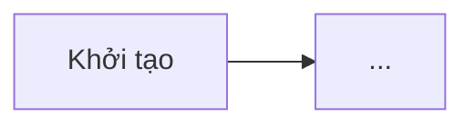
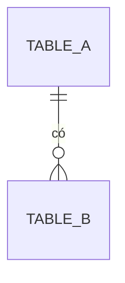

# FS-NNN — <Tên tính năng>

## Lịch sử thay đổi

| Version | Ngày | Người | Nội dung |
|---|---|---|---|
| 1.0 | YYYY-MM-DD | | Khởi tạo |

## 1. Tóm tắt

- **Mục tiêu:** <vấn đề nghiệp vụ được giải quyết>
- **Đối tượng sử dụng:** <vai trò>
- **Trong phạm vi:** <liệt kê>
- **Ngoài phạm vi:** <liệt kê>
- **Phụ thuộc:** <tính năng/module/hệ thống khác>

## 2. Thuật ngữ

| Thuật ngữ | Định nghĩa |
|---|---|

## 3. Actor & phân quyền

| Vai trò | Xem | Tạo | Sửa | Xoá | <Hành động nghiệp vụ> | Phạm vi dữ liệu |
|---|---|---|---|---|---|---|

## 4. Luồng nghiệp vụ

### 4.1 Luồng chính
1. ...

### 4.2 Luồng thay thế / ngoại lệ
- **A1 –** ...

## 5. Trạng thái & chuyển trạng thái

Trạng thái: `DRAFT` (khởi tạo) · ... · `<KẾT THÚC>`

| Từ trạng thái | Hành động (API) | Sang trạng thái | Điều kiện (guard) | Actor | Ghi lịch sử | Mã lỗi khi sai |
|---|---|---|---|---|---|---|

Được sửa ở trạng thái: ... · Được xoá ở trạng thái: ...

## 6. Business rules

| ID | Quy tắc | Áp dụng tại | Mã lỗi |
|---|---|---|---|
| BR-01 | | API-xx / SCR-xx | |

## 7. Data model

### 7.0 Nguồn & chế độ thiết kế

| Bảng | Chế độ | Nguồn |
|---|---|---|
| `<table_name>` | A — theo DB có sẵn \| B — tự thiết kế | `<file:dòng>` \| entity `<path>` \| — |

DDL: `specs/FS-NNN-<slug>.sql` (PostgreSQL; core chưa có Flyway/Liquibase).

### ENT-01 `<table_name>` — <tên thực thể>

Kế thừa: `EntityBase` | `EntitySoftDeleteBase` (lý do). Cột audit không liệt kê ở đây, nhưng có trong DDL.

| Cột | Kiểu | Null | Mặc định | Ràng buộc | Mô tả |
|---|---|---|---|---|---|
| id | uuid | N | | PK | |
| status | varchar(20) | N | | enum `<XStatus>` | |

- **Quan hệ:** ...
- **Index / unique:** ...
- **Enum:** `<XStatus>` = `DRAFT` (Nháp), ...

### 7.x ERD

### 7.y Đối chiếu DB có sẵn (chế độ A) / Quyết định thiết kế (chế độ B)

Chế độ A:

| Loại | Bảng.cột | Phát hiện | Đề xuất | Q |
|---|---|---|---|---|
| THIẾU \| THỪA \| LỆCH KIỂU \| RÀNG BUỘC \| LỆCH CORE | | | | Q-xx |

Chế độ B:

| Quyết định | Lý do | Phương án đã cân nhắc |
|---|---|---|

### 7.z Đề xuất thay đổi DB (chế độ A)

[Đề xuất] — chưa áp dụng cho tới khi chủ DB duyệt. Lệnh tương ứng nằm trong file DDL, đánh dấu `-- [Đề xuất] Q-xx`.

Không áp dụng – <lý do> (nếu không có).

## 8. API

Base path: `/<domain>/<resource>` · Response bọc `Response<T>` · Mọi endpoint kiểm tra quyền trừ khi ghi "Công khai".

| ID | Method | Path | Mô tả | Quyền (button_action) |
|---|---|---|---|---|
| API-01 | GET | /search | Tìm kiếm phân trang | view |
| API-02 | GET | /{id} | Chi tiết | view |
| API-03 | POST | /create | Tạo mới | create |
| API-04 | POST | /update | Cập nhật | update |
| API-05 | POST | /delete | Xoá | delete |

### API-01 GET /search

**Request (`<X>FilterRequest`, query):**

| Trường | Kiểu | Bắt buộc | Kiểu lọc | Mô tả |
|---|---|---|---|---|
| keyword | string | | chứa (mã, tên) | |
| page, size, sort | | | | Phân trang chuẩn |

**Response:** `PageResult<<X>Response>`

| Trường | Kiểu | Mô tả |
|---|---|---|

### API-03 POST /create

**Request (`<X>CreateRequest`, body):**

| Trường | Kiểu | Bắt buộc | Validate | Mã lỗi |
|---|---|---|---|---|

**Xử lý:** 1. ... (tham chiếu BR-xx)
**Response:** `Response<Void>` | `Response<UUID>`

### Mã lỗi

| Mã | Tiếng Việt | English |
|---|---|---|
| `<domain>.<field>.<rule>` | | |

## 9. Màn hình

### SCR-01 <Tên màn hình danh sách>

- **Đường dẫn FE:** `apps/web/src/pages/<Module>/<Screen>/index.tsx`
- **URL menu:** `/<module>/<screen>` · **loadingType:** `table-list-actions`
- **i18n namespace:** `<domain>`

**Bộ lọc:**

| Trường | Control | Nguồn dữ liệu | Mặc định |
|---|---|---|---|

**Bảng:**

| Cột | Trường | Định dạng | Sắp xếp |
|---|---|---|---|

Sắp xếp mặc định: ... · Empty state: `no-records` / `no-match`

**Hành động:**

| Nút | actionType | actionCode | Vị trí | Hiện khi | API | Xác nhận |
|---|---|---|---|---|---|---|

### SCR-02 <Form thêm/sửa> (Dialog | trang)

| Trường | Control | Bắt buộc | Validate (FE) | Chỉ đọc khi |
|---|---|---|---|---|

## 10. Menu & Permission seed (`sa_permission`)

| code | name | foreign_name | parent_code | type | module_code | url | path_folder | uri | method | button_action | sort_order |
|---|---|---|---|---|---|---|---|---|---|---|---|
| | | | | GROUP | | | | | | | |
| | | | | MENU | | /<module>/<screen> | <Module>/<Screen> | | | | |
| | | | | PAGE | | | <Module>/<Detail> | | | | |
| | | | | FUNCTION | | | | | | create | |
| | | | | API | | | | /<domain>/<resource>/create | POST | | |

## 11. Thông báo / Email

| Event code | Khi nào | Người nhận | Biến template |
|---|---|---|---|

Không áp dụng – <lý do> (nếu không có).

## 12. Acceptance criteria

| ID | BR | Given | When | Then |
|---|---|---|---|---|
| AC-01 | BR-01 | | | |

## 13. Yêu cầu phi chức năng

| Hạng mục | Yêu cầu |
|---|---|
| Hiệu năng | |
| Bảo mật / dữ liệu nhạy cảm | |
| Nhật ký / audit | |
| Lưu trữ | |

## 14. Giả định

- [Giả định] ...

## 15. Câu hỏi mở

| ID | Câu hỏi | Ảnh hưởng | Phương án đề xuất | Trạng thái |
|---|---|---|---|---|
| Q-01 | | Data model / Luồng / Quyền / Phạm vi | | Mở |

## 16. Truy vết

| Yêu cầu gốc (trích) | BR | AC | API | SCR |
|---|---|---|---|---|

## 17. Gợi ý phân rã cho dev

**BE (`bom-<domain>` / `res-<domain>`):**
- [ ] Chạy DDL `FS-NNN-<slug>.sql` (sau khi các đề xuất DB đã duyệt)
- [ ] Entity + repository: ENT-01
- [ ] DTO + service + controller: API-01..05
- [ ] Mã lỗi vào `messages.properties` / `messages_en.properties`
- [ ] Seed `sa_permission` (mục 10)

**FE (`apps/web`):**
- [ ] Service + query/mutation hooks
- [ ] SCR-01, SCR-02
- [ ] i18n `locales/<domain>/{vi,en}.json`
